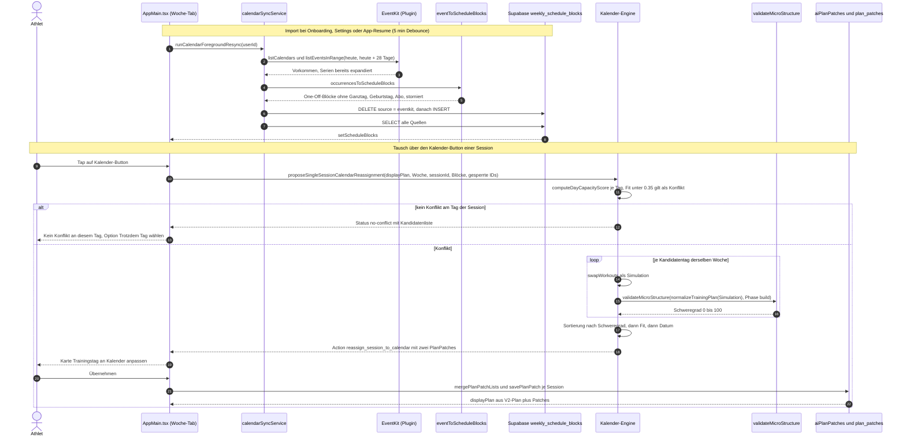
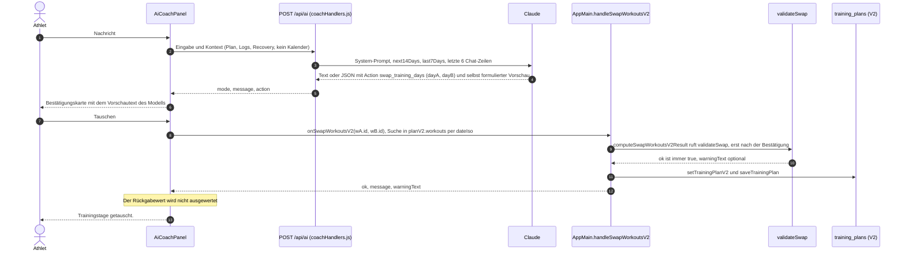

# MyRace – Kalender-System: Bestandsaufnahme

> **Stand:** 2026-10-06 · Branch `test/device-2026-10-03-post-plan` · Commit `7057888`
> **Art:** reine Analyse. Kein Code geändert, nichts committet. Zeilennummern gelten für diesen Commit.
> **Methode:** Code gelesen, dazu zwei Skripte außerhalb des Repos gegen die echten Module ausgeführt (Abschnitt 2, Anhang A). Die elf betroffenen Test-Suites wurden einmal ausgeführt (135 Tests, alle grün).
> **Nicht geprüft:** Verhalten auf dem iPhone 13, Daten in Supabase, Antworten des Chat-Modells. Was nur aus dem Code hergeleitet ist, trägt die Markierung **[hergeleitet]**. Unklares steht als **OFFEN** in Abschnitt 8.

Begriffe in diesem Dokument:

- **Kalender-Engine**: der deterministische Pfad hinter dem 📅-Button und dem Button „Woche auf Kalenderkonflikte prüfen" (`src/scheduling/**`, `src/ai/mutations/**`).
- **Chat-Swap**: der Tausch zweier Tage, den der Coach-Chat per Action `swap_training_days` auslöst.
- **Block**: eine Zeile in `weekly_schedule_blocks` (importierter Termin, Preset oder manuelle Zeile).

---

## 0. Kurzfassung

1. **Es gibt zwei getrennte Tausch-Systeme, die nichts voneinander wissen.** Die Kalender-Engine kennt den Kalender und rechnet deterministisch. Der Chat-Swap kennt den Kalender nicht, das Sprachmodell wählt die Tage frei. Beide schreiben in unterschiedliche Speicher.
2. **Der Samstag-Bug ist reproduziert.** Die Kalender-Engine schlägt für den Testfall wortgleich „Intervall: Di → Sa" und „Krafttraining: Sa → Di" vor, mit Schweregrad 0 und ohne Warnung (Abschnitt 2).
3. **Root Cause:** `validateMicroStructure` wird aufgerufen, sieht den Long Run aber als Belastungsklasse `low`. `normalizeTrainingPlan` setzt `long → low` und `tempo → medium`, und der Validator vertraut diesem Feld. „Intervall am Tag vor dem Long Run" ist damit für jede Regel unsichtbar.
4. **Die Tests prüfen eine andere Klassifikation als die Produktion.** Die Validator-Tests bauen Workouts ohne `intensity` und laufen damit über einen Fallback (`tempo → high`, `long → medium`), den echte Plandaten nie erreichen.
5. **Die harte Regel der Roadmap ist nicht erfüllt.** „Kalender-Constraints optimieren nur innerhalb der Trainingsplan-Regeln" greift heute verlässlich nur in zwei Fällen: Intervall direkt neben Intervall und Intervall direkt nach dem Long Run. In allen anderen Fällen entscheidet der freie Kalendertag, also meist das Wochenende.
6. **Der Chat-Swap validiert erst nach der Bestätigung und wirft das Ergebnis weg.** `validateSwap` läuft, der Tausch wird trotzdem immer gespeichert, die Warnung erreicht den Athleten nie.
7. **Konflikterkennung ist reine Zeitanteil-Rechnung.** Ein Konflikt entsteht erst, wenn mehr als 65 % des Tagesfensters belegt sind, oder wenn der Titel ein Sport-Stichwort enthält. „Prüfung", „abends Arbeit", Tageszeit und Dauer der Einheit spielen keine Rolle.
8. **Der Plan wird einmalig komplett bis zum Renntag erzeugt, ohne Kalender.** Der Kalender wirkt nur in nachträglichen Tauschen, und dort nur 28 Tage weit.
9. **Ein Kalender-Export existiert nicht.** Empfehlung: ICS-Abo-Feed zuerst (Abschnitt 5).
10. **Drei Datenrisiken in der Persistenz:** zwei Speicher-Ebenen für Tagestausche erzeugen doppelt belegte Tage, ein Kalender-Patch löscht einen früheren Inhalts-Patch derselben Session, und `plan_patches` hat keinen Planbezug.

---

## 1. Datenfluss End-to-End

### 1.1 Kalender einlesen

| Thema | Ist-Zustand | Fundstelle |
|---|---|---|
| Plugin | `@ebarooni/capacitor-calendar` 8.3.0 (EventKit). Lazy-Import an jeder Call-Site, nur iOS. | `src/calendar/calendarImportService.ts:17-19, 24, 41, 58` |
| Berechtigung | Full Access (`requestFullCalendarAccess`). Status-Check über `READ_CALENDAR`. Beide plist-Keys gesetzt. | `calendarImportService.ts:21-48`, `ios/App/App/Info.plist:27-30` |
| Purpose-String | „… Termine werden nicht verändert." Der Code-Kommentar sagt ebenfalls „Die App schreibt nie in den Kalender". Relevant für Abschnitt 5.2 b). | `Info.plist:28, 30`, `calendarImportService.ts:12` |
| Welche Kalender | Alle, die `listCalendars()` liefert. Keine Auswahl durch den Nutzer. Übersprungen werden nur die Typen `birthday` und `subscription`. | `calendarImportService.ts:60-72`, `src/calendar/eventToScheduleBlocks.ts:23, 55` |
| Zeitraum | Heute 00:00 lokal bis heute + 28 Tage (exklusiv). | `src/calendar/calendarSyncService.ts:25, 95-108` |
| Serientermine | EventKit expandiert sie bei der Bereichsabfrage selbst. Gespeichert werden Einzelvorkommen als One-Off-Zeilen, kein RRULE-Mapping. | `calendarImportService.ts:63`, `eventToScheduleBlocks.ts:6-9` |
| Zeitzonen | `startMs`/`endMs` werden mit lokalen `Date`-Gettern in Datum + `HH:MM` der **Gerätezeitzone zum Sync-Zeitpunkt** umgerechnet. Gespeichert wird `date` + `time` ohne Zone. Das Feld `timezone` des Plugins wird nicht gelesen. | `eventToScheduleBlocks.ts:87-114` |
| Ganztagstermine | Werden komplett verworfen. | `eventToScheduleBlocks.ts:54` |
| Weitere Filter | Storniert, kürzer als 5 Minuten, außerhalb des Fensters. | `eventToScheduleBlocks.ts:56-62` |
| Über Mitternacht | Split in Tagessegmente, Tag 1 endet 23:59. | `eventToScheduleBlocks.ts:87-110` |
| Dedupe | Titel (klein) + Datum + Start + Ende, über Kalender hinweg. | `eventToScheduleBlocks.ts:64-66` |
| Kategorie | Stille Stichwort-Heuristik auf Titel, dann Kalendername. Ohne Wirkung in der Engine. | `src/calendar/eventClassifier.ts:10-26` |
| Schreibweise | Replace-All: alle `source='eventkit'`-Zeilen löschen, dann neu einfügen. Nicht transaktional. Bei Fetch-Fehler wird nicht geschrieben. | `src/lib/supabase/services/weeklyScheduleBlocksService.ts:171-204`, `calendarSyncService.ts:101-111` |
| Nicht genutzte Plugin-Felder | `availability` (frei/gebucht), `attendees[].status` (abgelehnt), `url`, `description`, `id`, `timezone`. | `node_modules/@ebarooni/capacitor-calendar/dist/esm/schemas/interfaces/calendar-event.d.ts` |

**Auslöser des Imports** (drei, alle im Vordergrund):

| Auslöser | Fundstelle |
|---|---|
| Onboarding Schritt 4 „Kalender verbinden" | `src/components/Onboarding.tsx:330-375` |
| Settings-Card „Kalenderzugriff aktivieren" | `src/AppMain.tsx:2047-2079` |
| App kommt in den Vordergrund (`appStateChange`), 5 Minuten Debounce, nur mit Connected-Marker und erteilter Berechtigung | `src/AppMain.tsx:1839-1863`, `calendarSyncService.ts:123-133` |

Es gibt keinen Hintergrund-Sync und keinen eigenen Kaltstart-Aufruf. Beim Kaltstart lädt die App die zuletzt gespeicherten Blöcke aus Supabase (`AppMain.tsx:1486, 1504-1506`). Ob `appStateChange` beim Kaltstart feuert, ist **OFFEN** (Frage 5).

Der Zustand „verbunden" liegt nur lokal (`localStorage`-Key `calendarImportConnected`, `calendarSyncService.ts:22`). „Trennen" setzt nur diesen Marker zurück, bereits importierte Zeilen bleiben stehen (`AppMain.tsx:2081-2085`).

### 1.2 Manuelle Termine und Blöcke

| Thema | Ist-Zustand | Fundstelle |
|---|---|---|
| Tabelle | `public.weekly_schedule_blocks`, RLS `user_own_data`. Wiederkehrend (`day_of_week`, 0 = Sonntag, optional Gültigkeitszeitraum) oder einmalig (`specific_date`). `start_time`/`end_time` als `time`, `end_time > start_time`. | `supabase/migrations/009_weekly_schedule_blocks.sql` |
| `source`-Spalte | `'manual' \| 'eventkit' \| 'preset'`, Default `'manual'`. | `supabase/migrations/010_weekly_schedule_blocks_source.sql` |
| `eventkit` | Geschrieben vom Import (1.1). | `calendarSyncService.ts:110` |
| `preset` | Onboarding-Fallback: Vollzeit, Teilzeit, Studium, Schicht. Wiederkehrende Zeilen ab heute, ohne Enddatum. Ein neues Preset ersetzt das alte. | `src/calendar/presets.ts:34-96`, `Onboarding.tsx:377-396` |
| `manual` | **Es gibt keine Eingabe-UI.** `saveWeeklyScheduleBlock` und `deleteWeeklyScheduleBlock` existieren, werden aber nirgends aufgerufen. Manuelle Zeilen entstehen heute nur per SQL (Testdaten). | `weeklyScheduleBlocksService.ts:133-143, 206-215` |
| Andere Tabellen | Keine weitere Tabelle für Termine. Tauschergebnisse landen in `plan_patches` bzw. `training_plans` (1.5). | `supabase/migrations/001_initial_schema.sql:35-42` |
| Zusammenführung | `loadWeeklyScheduleBlocks` lädt alle Quellen in eine Liste. `computeDayCapacityScore` bildet die Vereinigung der Zeitintervalle, Überlappungen zählen einmal. Es gibt keine Priorität zwischen den Quellen. | `weeklyScheduleBlocksService.ts:112-131`, `src/scheduling/capacityScore.ts:96-121, 127-160` |
| App-State | `scheduleBlocks` ist reiner React-State, nicht in `localStorage`. Ohne Blöcke sind beide Kalender-Buttons ausgeblendet. | `AppMain.tsx:1305, 5123, 5345` |

Folge der fehlenden Priorität: Ein Preset „Arbeit Mo–Fr 9–17" bleibt nach späterem Kalender-Connect bestehen und blockiert auch Urlaubs- und Feiertage weiter.

### 1.3 Konflikterkennung

**Wann sie läuft:** nur auf Knopfdruck, für die gerade angezeigte Woche.

| Einstieg | Funktion | Fundstelle |
|---|---|---|
| 📅-Button an einer Session (nicht Ruhetag, nicht gesperrt, Blöcke vorhanden) | `proposeSingleSessionCalendarReassignment` | `AppMain.tsx:5345-5347, 2854-2863`, `src/ai/mutations/buildCalendarReassignmentAction.ts:156-178` |
| Button „📅 Woche auf Kalenderkonflikte prüfen" | `scanWeekForCalendarConflicts` | `AppMain.tsx:5123-5144, 2894-2909`, `src/ai/mutations/scanWeekForCalendarConflicts.ts:42-65` |

Kein automatischer Scan beim Import, kein Hinweis-Badge, keine Benachrichtigung. Das entspricht dem Akzeptanzkriterium von Roadmap-Schritt 6.

**Wie bewertet wird** (`src/scheduling/capacityScore.ts`):

1. Tagesfenster: werktags 06:00–22:00, am Wochenende 07:00–23:00, jeweils 960 Minuten (`:18-19`).
2. `capacityScore = freie Minuten / 960` (`:127-160`).
3. Fit-Score je Session-Typ (`:187-192`):
   - `tempo`, `interval`, `race`, `long`: Fit = `capacityScore`.
   - Alle anderen (`easy`, `strength`, `bike`, `rest`): Fit = `1 − (1 − capacityScore) × 0,1`, also nie unter 0,9.
   - Harte Session an einem Tag mit Sport-Termin: Fit höchstens 0,2.
4. Konflikt, wenn Fit < 0,35 (`MIN_FIT_SCORE_THRESHOLD`, `src/ai/mutations/assignSessionToBestCapacityDay.ts:55, 61-63`).

Daraus folgt für die Praxis:

| Fall | Ergebnis |
|---|---|
| Harte Einheit, Tag zu mehr als 65 % belegt (über 10 h 24 min im Fenster) | Konflikt |
| Harte Einheit, Tag zu 50 % belegt | kein Konflikt |
| Leichte Einheit, Tag zu 100 % belegt | kein Konflikt (Fit 0,9) |
| Harte Einheit + Termin mit Sport-Stichwort im Titel | Konflikt |
| Termin heißt „Sprint-Prüfung" | kein Sport-Stichwort, zählt nur als Zeit |
| „Arbeit abends" 17–22 Uhr | 5 von 16 Stunden, kein Konflikt |
| Nachtschicht 22–06 Uhr | liegt außerhalb beider Fenster, zählt mit 0 Minuten |
| Ganztagstermin | wurde beim Import verworfen, existiert nicht |

> **Stand nach Schritt 6 (`feat/event-load-semantics`, 2026-10-07):** Die Zeile „Sprint-Prüfung" in der Tabelle gilt nicht mehr — der Termin ist jetzt körperlich belastend (Konflikt für harte Einheiten am selben Tag, ⚠️ für harte Einheiten an den Nachbartagen). Die Stichwörter liegen in `src/scheduling/eventLoad.ts`; die Kategorie wirkt als Bremse („Sprint" im Job-Kalender). Details in `docs/roadmap.md`, „Schritt 6". Der folgende Absatz beschreibt den Stand der Analyse.

Die Sport-Stichwörter stehen in `PHYSICAL_LOAD_TITLE_KEYWORDS` (`capacityScore.ts:45-64`). „Prüfung", „Klausur", „Schicht", „Reise" sind nicht enthalten. Die Kategorie (`study`, `job` …) wird gespeichert, aber von keiner Regel gelesen.

Nicht bewertet werden: Tageszeit des Termins, Dauer der Einheit, zusammenhängende freie Lücke, mentale Belastung, Recovery-Daten.

### 1.4 Vorschlag und Tausch

Es gibt **vier** Wege zu einem Tagestausch. Nur die ersten drei kennen den Kalender.

| # | Pfad | Wer wählt den Zieltag | Einstieg |
|---|---|---|---|
| A1 | 📅 Einzel-Vorschlag | Kalender-Engine (`assignSessionToBestCapacityDay`) | `AppMain.tsx:2854` |
| A2 | 📅 manuelle Tageswahl („Bearbeiten" / „Trotzdem Tag wählen") | Athlet, aus der Rangliste der Engine | `AppMain.tsx:2879-2892` |
| A3 | Wochen-Batch | Kalender-Engine, Greedy über alle Konflikte | `AppMain.tsx:2894-2916` |
| B | Chat-Swap | Sprachmodell (`swap_training_days {dayA, dayB}`) | `src/components/ai/AiCoachPanel.tsx:171-197` |

**Zu den im Auftrag genannten Kandidaten:**

- *Capacity Engine*: ja, Pfade A1–A3.
- *AiPlanWeek / PlanPatch / applyPlanPatches*: ja, das ist das Datenformat der Pfade A1–A3.
- *Coach-Chat via `api/_lib/coachHandlers.js`*: ja, Pfad B. Er nutzt weder Capacity Engine noch PlanPatches.

**Pfad A – Zieltagwahl im Detail** (`assignSessionToBestCapacityDay.ts`):

1. Kandidaten sind alle anderen, nicht gesperrten Sessions **derselben Woche**. Ein „Zieltag" ist immer die Session, die dort liegt. Es wird stets getauscht, nie nur verschoben (`buildCalendarReassignmentAction.ts:29-44`).
2. Gesperrt sind: Rennen, erledigt, übersprungen, Datum vor heute (`src/ai/mutations/lockedSessions.ts:17-34`).
3. Je Kandidat wird der Tausch simuliert und mit `validateMicroStructure` bewertet (`:144-174`). Ergebnis ist ein Schweregrad 0–100.
4. Je Kandidat wird der Kalender-Fit beider Seiten berechnet, das Minimum zählt (`combinedFit`, `:164-172`).
5. Sortierung: niedrigster Schweregrad, dann höchster Fit, dann frühestes Datum (`:190-194`).
6. Der Erste gewinnt. Liegt sein Fit unter 0,35, gibt es keinen Vorschlag (`:235-237`). Liegt sein Schweregrad bei 60 oder höher, wird eine Warnzeile angehängt (`:252`).
7. Der Validator-Kontext ist fest verdrahtet: Phase `build`, Recovery neutral (`NEUTRAL_VALIDATION_CONTEXT`, `:32-44`). Kein Aufrufer in `AppMain.tsx` übergibt die echte Phase (`buildCalendarReassignmentAction.ts:167, 175`, `AppMain.tsx:2885, 2902`).

Der Wochen-Batch (A3) nutzt dieselbe Rangliste, nimmt je Konflikt den ersten Kandidaten ohne Konflikt-Flag und prüft am Ende den Gesamtzustand noch einmal (`src/ai/mutations/proposeWeekCalendarReassignments.ts:57-100`, `src/ai/mutations/validateWeekReassignmentBatch.ts:65-147`).

**Pfad B – Chat-Swap im Detail:**

1. `AiCoachPanel` schickt Eingabe und Kontext an `POST /api/ai` (`AiCoachPanel.tsx:76-95`, `src/lib/ai/coachAgent.ts:63-127`).
2. Der Kontext enthält Plan, Logs, Health-Läufe und Recovery, **aber keine Blöcke** (`src/lib/ai/getAiContext.ts:49-66`). `scheduleBlocks` wird außerhalb von `AppMain.tsx` und der Kalender-Engine nirgends gelesen.
3. Der Server kürzt den Plan auf 14 Tage voraus und 7 zurück. Je Session gehen nur Datum-Label, Wochentag, Titel, km, Typ und Pace an das Modell, **keine Session-ID und kein ISO-Datum** (`api/_lib/coachHandlers.js:576-585, 705-769`).
4. Der System-Prompt enthält keine Regel zu Erholungsabständen, zum Long Run oder zum Kalender (`coachHandlers.js:799-836`). Die einzige Tausch-Action ist `swap_training_days` mit zwei ISO-Daten (`:828`).
5. Das Modell wählt beide Tage frei und schreibt auch Titel und Zeilen der Bestätigungskarte selbst (`preview`). Der Server übernimmt diesen Text unverändert (`coachHandlers.js:388-407`). Der Kartentext wird also **nicht** aus der Action abgeleitet und kann etwas anderes versprechen, als der Tausch tut. Nur wenn das Modell keine Vorschau liefert, erzeugt der Client „Trainingstage tauschen" mit `dayA ↔ dayB` (`src/lib/ai/actions.ts:292-302`).

Nicht am Live-Pfad angeschlossen sind `mockBrain.ts`, `coachBrain.ts`, `generateAiResponse.ts`, `coachDeterministicResponses.ts`, `src/ai/intents/**` (`parseIntent`, `resolveSwap`, `resolveReplaceWorkoutProposal`) und `coachSystemPrompt.ts`. Sie werden nur untereinander und von Tests importiert. `AiCoachPanel` ruft ausschließlich `runCoachAgent`. Der Datei-Anker der Roadmap „`coachSystemPrompt.ts` – Coach-Persona/Regeln" zeigt damit auf eine Datei ohne Importeur. Der wirksame Prompt steht in `coachHandlers.js:799-836`.

„Krafttraining als Ersatz" kann der Chat nur als Text vorschlagen. Die Action `replace_workout` steht nicht in der Server-Allow-List (`api/_lib/aiSchema.js:1-16`) und wird verworfen (`coachHandlers.js:409-417`).

### 1.5 Anwendung und Persistenz

| | Pfad A (Kalender-Engine) | Pfad B (Chat-Swap) |
|---|---|---|
| Datenebene | `AiPlanWeek` + `PlanPatch` | `TrainingPlanV2` |
| Was wird geschrieben | Zwei Patches mit absolutem `{day, date, dateIso}` | `dateIso` der beiden Workouts wird getauscht, Wochen neu abgeleitet |
| Funktion | `handleAiApplyPlanPatches` → `mergePlanPatchLists` → `savePlanPatch` | `handleSwapWorkoutsV2` → `computeSwapWorkoutsV2Result` → `saveTrainingPlan` |
| Fundstelle | `AppMain.tsx:2669-2719`, `src/mutations/commitPlanPatchMutation.ts:13-50`, `src/lib/supabase/services/planPatchesService.ts:46-63` | `AppMain.tsx:2756-2778`, `src/mutations/computeSwapWorkoutsV2Result.ts:19-74`, `src/ai/mutations/swapWorkoutDates.ts:6-22` |
| Speicher | State `aiPlanPatches`, `localStorage`, Tabelle `plan_patches` (nur INSERT) | State `trainingPlanV2`, `localStorage`, Tabelle `training_plans.data` |
| Bestätigung | Karte „Übernehmen" im Woche-Tab (A1, A3). Bei manueller Tageswahl (A2) wird **sofort** gespeichert, ohne Karte. | Karte im Coach-Tab, Text vom Modell |

Die Anzeige entsteht immer aus beiden Ebenen: `displayPlan = V2-Plan → Wochenzeilen → applyPlanPatches(aiPlanPatches)` (`src/displayPlan/deriveDisplayPlan.ts:15-21`, `AppMain.tsx:2434`).

**Was mit dem restlichen Wochenplan passiert:** nichts. Beide Pfade tauschen genau zwei Sessions. Es gibt keine Folgeanpassung, kein Kürzen, kein Abschwächen der Nachbartage, keine Neuberechnung der Wochenkilometer (bei Tausch innerhalb der Woche bleiben sie gleich). Session-IDs bleiben erhalten, `w12-di` liegt danach am Samstag.

### 1.6 Sequenzdiagramme

**Import und Tausch über die Kalender-Engine (Pfad A1):**



**Tausch über den Coach-Chat (Pfad B):**



---

## 2. Repro des Samstag-Bugs

### 2.1 Testaufbau

Woche in der Peak-Phase, heute = Dienstag 2026-10-06, Montag ist vergangen und damit gesperrt:

| Tag | Session | Typ | Termine |
|---|---|---|---|
| Mo 05.10. | Ruhetag | `rest` | – |
| **Di 06.10.** | **Bahnintervalle 6×1000 m** | `interval` | „Sprint-Prüfung" 08–14, „Arbeit" 16–22 |
| Mi 07.10. | Lockerer Dauerlauf | `easy` | „Arbeit" 09–17 |
| Do 08.10. | GA1-Dauerlauf | `easy` | „Arbeit" 09–17 |
| Fr 09.10. | Ruhetag | `rest` | „Arbeit" 09–17 |
| Sa 10.10. | Krafttraining | `strength` | frei |
| **So 11.10.** | **Marathon-Pace-Long-Run 28 km** | `long` | frei |

Ausgeführt wurde der unveränderte Produktivcode von `proposeSingleSessionCalendarReassignment` (Skript in Anhang A).

### 2.2 Ergebnis

```
Di 2026-10-06 interval  capacity=0.250  fit=0.250          ← Konflikt (unter 0.35)
Intensität laut Validator:
  interval=high  easy=low  strength=low  long=low           ← Long Run gilt als "low"

Ranking (beste zuerst):
  2026-10-10  Sa  severity=0  fit=0.925  isConflict=false   ← Gewinner
  2026-10-07  Mi  severity=0  fit=0.500  isConflict=false
  2026-10-08  Do  severity=0  fit=0.500  isConflict=false
  2026-10-09  Fr  severity=0  fit=0.500  isConflict=false
  2026-10-11  So  severity=0  fit=0.250  isConflict=true

Vorschlag:
  "Bahnintervalle 6x1000m: Di → Sa (10. Okt) – wegen Kalendertermin"
  "Krafttraining: Sa → Di (6. Okt)"
  (keine Warnzeile)
```

Das ist das gemeldete Verhalten: Krafttraining rückt auf den Prüfungstag, das Intervall landet am Samstag, direkt vor dem Marathon-Pace-Long-Run, ohne Hinweis.

### 2.3 Welcher Code wählt den Samstag

| Schritt | Code | Was passiert |
|---|---|---|
| 1 | `buildCalendarReassignmentCandidates` (`buildCalendarReassignmentAction.ts:29-44`) | Mi, Do, Fr, Sa, So werden Kandidaten. |
| 2 | `scoreCandidate` (`assignSessionToBestCapacityDay.ts:156-159`) | Für Sa wird Di↔Sa simuliert, in V2 normalisiert und an `validateMicroStructure` gegeben. |
| 3 | `normalizeIntensity` (`src/planV2/normalizeTrainingPlan.ts:33-42`) | `AiPlanSession` hat kein Feld `intensity`. Die Normalisierung setzt `interval → high`, `tempo → medium`, **alles andere inklusive `long` → low**. |
| 4 | `inferIntensity` (`src/ai/validation/validateMicroStructure.ts:27-32`) | Erste Zeile: `if (w.intensity) return w.intensity`. Der eigene Fallback (`tempo → high`, `long → medium`) wird nie erreicht. |
| 5 | Regel 1 (`validateMicroStructure.ts:108-110`) | Verlangt `high` + `high` an Nachbartagen. Sa `high`, So `low`. Greift nicht. |
| 6 | Regel 1b (`:113-121`) | Verlangt, dass der Folgetag nicht `low` ist. So ist `low`. Greift nicht. |
| 7 | Regel 2 (`:124-135`) | Prüft nur, was **nach** einem Long Run kommt. Der Tag davor wird nie betrachtet. |
| 8 | Sortierung (`assignSessionToBestCapacityDay.ts:190-194`) | Alle Kandidaten haben Schweregrad 0. Es entscheidet der Fit. |
| 9 | `combinedFit` (`:164-172`) | Sa ist frei (1,0). Das verdrängte Krafttraining passt als leichte Einheit auf den vollen Dienstag (0,925). Werktage mit Arbeit liegen bei 0,5. **Samstag gewinnt.** |
| 10 | `:252` | Schweregrad 0 liegt unter 60, also keine Warnung. |

### 2.4 Werden `validateMicroStructure` und `validateSwap` aufgerufen?

| Pfad | `validateMicroStructure` | `validateSwap` | Wirkung |
|---|---|---|---|
| A1 📅 Einzel-Vorschlag | **ja**, je Kandidat | nein | Bestimmt die Rangfolge. Für den Testfall Ergebnis 0. |
| A2 📅 manuelle Tageswahl | ja, für die Liste und nochmals nach der Wahl | nein | Liste zeigt „⚠️ Ungünstig" ab 60. Die Warnung nach der Wahl wird nicht angezeigt, es wird sofort gespeichert. |
| A3 Wochen-Batch | ja, je Kandidat und einmal für den Endzustand | nein | Wie A1. |
| B Chat-Swap | ja, indirekt | **ja** | Läuft erst nach „Tauschen". Blockiert nie. `warningText` wird von `AiCoachPanel.tsx:189-196` ignoriert. |

Für Pfad B wurde derselbe Tausch Di↔Sa mit `computeSwapWorkoutsV2Result` gerechnet. Ergebnis: `ok=true`, `warningText=null`. Auch `buildSwapAthleteFacingWarnings` schweigt, weil es nur „Long Run, am Folgetag Intervall/Tempo" kennt, nicht die umgekehrte Reihenfolge (`src/ai/validation/validateSwap.ts:71`).

### 2.5 Root Cause

**Die Belastungsklasse einer Session ist an mehreren Stellen unterschiedlich definiert, und der Validator liest die schwächste.**

| Stelle | interval | tempo | long | race |
|---|---|---|---|---|
| `capacityScore.ts:163` (Kalender-Fit) | hart | hart | **hart** | hart |
| `normalizeTrainingPlan.ts:33-42` (schreibt `intensity`) | high | **medium** | **low** | high |
| `validateMicroStructure.ts:27-32` Fallback (nur ohne `intensity`) | high | high | medium | high |
| `api/_lib/deterministicPlanGenerator.js:54-58` | high | high | medium | high |
| `src/lib/ai/actions.ts:19` (`HARD_TYPES`) | hart | hart | – | hart |
| `api/_lib/planWorkoutUtils.js:381` (nach dem Rennen verboten) | ja | ja | ja | ja |

Der Kalender-Fit behandelt den Long Run als harte Einheit. Die Trainingsregel direkt daneben behandelt ihn als lockeren Tag. Damit ist „Intervall am Vortag eines Long Runs" keine Regelverletzung, und die Engine optimiert nur noch auf freie Zeit.

Die Tests decken das nicht auf. `validateMicroStructure.test.ts` baut Workouts über `rebuildPlanFromWorkouts` ohne `intensity` und prüft damit den Fallback aus Zeile 3 der Tabelle. Produktivdaten laufen immer durch `normalizeTrainingPlan`.

### 2.6 Beitragende Ursachen

Diese Punkte verursachen den Testfall nicht allein, verschärfen ihn aber oder lassen ihn nach einer Korrektur der Klassifikation wieder auftreten.

1. **Phase wird nie übergeben.** Die Engine rechnet immer mit `build`. Mit Sonntag = `tempo` ergäbe Regel 1b in der Peak-Phase 80 (Warnung), mit `build` nur 55 (keine Warnung). Gemessen in Anhang A, Block B.
2. **Der Validator bewertet den ganzen Plan, nicht die Änderung.** Der Schweregrad ist das Maximum über alle Wochen, auch vergangene. Liegt irgendwo im Plan bereits ein Befund mit 55, haben alle Kandidaten mindestens 55 und der Fit entscheidet wieder. Reproduziert: Mit Sonntag = `tempo` wählt die Engine korrekt den Mittwoch. Mit einer alten Woche 3, die „Intervall, am Folgetag Tempo" enthält, wählt sie wieder den Samstag (Anhang A, Block D).
3. **Frühe Rückgabe.** Regel 1 und Regel 2 verlassen die Funktion beim ersten Treffer im ganzen Plan (`validateMicroStructure.ts:109, 128, 131`). Ein alter Verstoß in Woche 2 gibt jedem Kandidaten 95.
4. **Nur drei Gründe zählen.** `.slice(0, 3)` nimmt die ersten drei Warnungen in Einfügereihenfolge, nicht die schwersten (`:144`).
5. **Wochengrenze.** Geprüft wird nur innerhalb einer Kalenderwoche (`:34-44, 98-101`). Sonntag hart und Montag hart wird nicht erkannt (Anhang A, Block E).
6. **Kalender-Bias Richtung Wochenende.** Wer werktags arbeitet, hat am Samstag fast immer den besten Fit. Der Samstag liegt bei den meisten Plänen direkt vor dem Long Run.
7. **Nur Tausch innerhalb der Woche.** Verschieben auf einen Ruhetag ist nur als Tausch mit dem Ruhetag möglich, die Folgewoche ist kein Kandidat, Kürzen oder Streichen gibt es nicht.

### 2.7 Was nicht geklärt ist

- **Welchen Pfad der Athlet genommen hat** (Frage 1). Pfad A reproduziert die Meldung wortgleich. Pfad B kann dasselbe Ergebnis liefern, ist aber nicht deterministisch nachstellbar. Die Formulierung „nach Rückfrage" passt zur Bestätigungskarte von Pfad A, zum „Trotzdem Tag wählen" von A2 und zu einer Chat-Nachfrage in Pfad B.
- **Wie lang die Termine waren** (Frage 2). Mit Prüfung 2 h + Arbeit 5 h erkennt die Engine keinen Konflikt und zeigt „Kein Konflikt an diesem Tag". In der Liste hinter „Trotzdem Tag wählen" steht der Samstag dann auf Platz 1 ohne Warnflag (Anhang A, Fall A3).
- **Welchen Typ die Sonntags-Einheit im echten Plan hat** (Frage 3). Der Befund gilt sicher für `long`. Für `tempo` gilt er nur zusammen mit Ursache 1 oder 2.

Unterscheiden lassen sich die Pfade am Ort der Karte. Pfad A zeigt sie im Woche-Tab mit dem festen Titel „Trainingstag an Kalender anpassen" (`buildCalendarReassignmentAction.ts:96`). Pfad B zeigt sie im Coach-Tab und antwortet nach der Bestätigung mit „Trainingstage getauscht." (`AiCoachPanel.tsx:194`). Alternativ klärt es diese Prüf-Abfrage im Supabase SQL-Editor:

```sql
-- Pfad A hinterlässt zwei Zeilen mit day/date/dateIso zur selben Sekunde
select session_id, changes, reason, applied_at
from public.plan_patches
where user_id = '<USER_ID>'
order by applied_at desc
limit 10;
```

---

## 3. Bewertungs- und Tauschregeln

### 3.1 Regelinventar

Legende: ✔ greift · ◐ greift eingeschränkt · ✖ greift nicht

| # | Regel | Implementierung | A1 📅 | A2 manuell | A3 Batch | B Chat-Swap |
|---|---|---|---|---|---|---|
| R1 | Zwei `high`-Einheiten an Nachbartagen → 95 | `validateMicroStructure.ts:108-110` | ◐ | ◐ | ◐ | ◐ |
| R2 | Nach `high` am Folgetag nur `low` → Taper 95, Peak 80, Build 55, Base 40 | `:113-121` | ◐ | ◐ | ◐ | ◐ |
| R3 | Nach Long Run weniger als 2 Tage Abstand → 92, bei `medium` 70 | `:124-135` | ◐ | ◐ | ◐ | ◐ |
| R4 | Drei `high` in vier Tagen → 60 / 80 / 85 | `:82-96` | ◐ | ◐ | ◐ | ◐ |
| R5 | Woche ohne Ruhetag → 35 / 55 / 65 | `:75-79` | ◐ | ◐ | ◐ | ◐ |
| R6 | Kalender-Fit unter 0,35 → Konflikt bzw. kein Vorschlag | `assignSessionToBestCapacityDay.ts:55, 235` | ✔ | ✖ (Athlet darf übersteuern) | ✔ | ✖ |
| R7 | Sport-Termin im Titel deckelt harte Einheiten auf 0,2 | `capacityScore.ts:45-83, 174-191` | ✔ | ◐ (nur Flag) | ✔ | ✖ |
| R8 | Beide Seiten des Tauschs zählen (`combinedFit`) | `assignSessionToBestCapacityDay.ts:164-172` | ✔ | ◐ | ✔ | ✖ |
| R9 | Gesperrt: Rennen, erledigt, übersprungen, vergangen | `lockedSessions.ts:17-34` | ✔ | ✔ | ✔ | ✖ |
| R10 | Zieltag nur in derselben Woche | `buildCalendarReassignmentAction.ts:36` | ✔ | ✔ | ✔ | ✖ (jeder Tag möglich) |
| R11 | Phasenregeln: `high` in Taper, Long Run in Base, Peak-Kompression | `src/ai/validation/validatePhaseSwap.ts:39-78` | ✖ | ✖ | ✖ | ◐ |
| R12 | Wochenumfang steigt um mehr als 30 % | `src/ai/validation/validateLoadShift.ts:40-50` | ✖ | ✖ | ✖ | ◐ |
| R13 | Recovery-Achse | `validateSwap.ts:128-142` | ✖ | ✖ | ✖ | ◐ |
| R14 | Athleten-Hinweise: Long Run dann Intervall/Tempo, hart-hart, Ruhetag-Puffer verloren | `validateSwap.ts:55-90` | ✖ | ✖ | ✖ | ◐ |
| R15 | Struktur-Integrität (IDs, Daten) | `validatePlanIntegrity.ts`, `validateTrainingPlanV2Integrity.ts` | ✔ | ✔ | ✔ | ✔ |
| R16 | Long-Run-Deckel 30 % / 33 % des Wochenumfangs | `api/_lib/planWorkoutUtils.js:29-31, 301-379` | – | – | – | – |
| R17 | Nach dem Rennen keine harten Einheiten | `planWorkoutUtils.js:381-410` | – | – | – | – |
| R18 | Intervall- und Tempotag nicht aufeinanderfolgend | nur Prompt (`api/_lib/claudePlanGenerator.js:44, 201`) und festes Wochenmuster (`deterministicPlanGenerator.js:260-293`) | – | – | – | – |
| R19 | Chat-Schutz: müde + Intervalle, Schmerz + Laufen, krank + Training → feste Antwort | `coachHandlers.js:180-221, 1317-1326` | – | – | – | ◐ (nur Text) |

Was „◐" jeweils bedeutet:

- **R1–R5 in Pfad A:** Die Regeln laufen, aber mit falscher Belastungsklasse (`long = low`, `tempo = medium`), fester Phase `build`, neutralem Recovery, auf dem ganzen Plan statt auf der Änderung und ohne Wochengrenze. Alles nur Warnung, nie Sperre.
- **R1–R5 und R11–R14 in Pfad B:** Sie laufen mit echter Phase und echtem Recovery, aber erst nach der Bestätigung, und das Ergebnis wird nicht angezeigt. Faktisch wirkungslos.
- **R16–R18:** gelten nur bei der Plan-Erzeugung. Ein späterer Tausch kann R18 jederzeit brechen.

### 3.2 Belastungsklassen

Siehe Tabelle in 2.5. Es gibt keine gemeinsame Quelle. Eine Unterscheidung „lockerer Long Run" gegen „Long Run mit Marathon-Pace-Anteilen" existiert nirgends, beide haben den Typ `long`.

### 3.3 Recovery-Daten

- **Kalender-Engine:** liest Recovery nicht. Der Kontext ist konstant (`assignSessionToBestCapacityDay.ts:32-44`).
- **Chat-Swap:** Recovery-Score und Konfidenz gehen in `buildValidationContext` (`AppMain.tsx:2763-2767`, `src/ai/validation/buildValidationContext.ts:67-73`).
- **Wirkung der Recovery-Achse:** `Score = 35 + (50 − Recovery)/25 × Recovery × (0,3 + 0,7 × Konfidenz)`. Das Maximum liegt bei Recovery 25 und Konfidenz 1 und beträgt genau 60. Bei Recovery 0 ergibt die Formel 35. Die Achse erreicht die Warnschwelle also praktisch nie, und der am stärksten ermüdete Athlet bekommt den niedrigsten Wert. **[aus der Formel gerechnet, `validateSwap.ts:133-135`, `src/recovery/getRecoveryInfluence.ts:1-3`]**
- **Chat-Text:** Der Prompt sagt „widersprich niedrigem Recovery nicht" (`coachHandlers.js:834`). Das ist eine Bitte an das Modell, keine Prüfung.

### 3.4 Tageszeit

Es gibt keine Regel. Die Fenster 06–22 und 07–23 sind nur der Nenner der Zeitanteil-Rechnung. Sessions haben keine Uhrzeit und keine Dauer. Ob eine freie Lücke am Stück für die Einheit reicht, wird nicht geprüft.

### 3.5 Pfade, die die Validierung umgehen

| Pfad | Was fehlt |
|---|---|
| **Chat-Swap** (`AiCoachPanel.tsx:171-197`) | Validierung nach der Entscheidung, Ergebnis verworfen. Keine Sperre für erledigte oder vergangene Sessions. Keine Kalenderprüfung. Tausch über Wochen hinweg möglich. |
| **Manuelle Tageswahl A2** (`AppMain.tsx:2883-2892`) | Kein Fit-Limit (bewusst). Nach dem Tap wird sofort gespeichert, die Warnung aus `assignSessionToChosenDay` wird nicht gezeigt. |
| **Chat-Actions mit Datums-Patches** (`shift_race_date`, `shift_plan_start_date`, `src/lib/ai/actions.ts:162-215`) | Verschieben alle kommenden Sessions per Patch. Weder Micro-Structure noch Kalender werden geprüft. |
| **Chat-Actions mit Inhalts-Patches** (`adjust_plan_for_illness`, `taper_before_race`, `boost_next_week_volume`, `adapt_plan_injury_no_run`, `integrate_missed_workout`) | Ändern Typ und Umfang. Keine Micro-Structure-Prüfung des Ergebnisses. |
| **`convert_workout_to_run`** (`AppMain.tsx:2672-2710`) | Schreibt direkt in den V2-Plan, nur Integritätsprüfung. |
| **Vom Server eingesetzte Action** (`coachHandlers.js:409-417, 447-490`) | Liefert das Modell keine oder eine nicht erlaubte Action, setzt der Server `adjust_plan_for_illness` ein, sobald Müdigkeits-, Krankheits- oder Schmerzwörter im Text stehen oder der Recovery-Score unter 40 liegt. Die Karte ändert bis zu vier kommende Einheiten, ohne dass das Modell das vorgeschlagen hat. Nebenbefund außerhalb des Kalender-Themas **[hergeleitet]**. |
| **Plan-Erzeugung** | Kein Aufruf von `validateMicroStructure` auf dem erzeugten Plan. Wochenstruktur wird dem Modell bzw. dem festen Muster überlassen. |
| **Wochen-Scan** (`scanWeekForCalendarConflicts.ts:26-41`) | Bewertet bewusst nur den Kalender, nicht die Trainingsstruktur des Ist-Zustands. |

---

## 4. Plan-Generierung heute

### 4.1 Ablauf

| Schritt | Was | Fundstelle |
|---|---|---|
| 1 | Onboarding Schritt 5 ruft `fetchFullPlanFromClaude(profile)`. | `Onboarding.tsx:399-442`, `src/lib/ai/claudePlanService.ts:118-176` |
| 2 | `POST /api/onboarding/generate-plan-full`, Laufzeit bis 240 s. | `api/onboarding/generate-plan-full.js` |
| 3 | Ein Struktur-Aufruf liefert Phasen, Session-Namen und Regeln (`restDays`, `longRunDay`, `intervalDay`, `tempoDay`). | `api/_lib/claudePlanGenerator.js:166-268` |
| 4 | Wochenumfänge werden deterministisch berechnet und dem Modell als Pflichtwert mitgegeben. | `api/_lib/weeklyVolumeProgression.js:39`, `api/_lib/phasedFullPlanGenerator.js:314-319` |
| 5 | Je Phase (Base, Build, Peak, Taper) erzeugt ein Haiku-Aufruf **alle sieben Tage jeder Woche**. Lange Phasen werden in Blöcke von höchstens 6 Wochen geteilt. | `phasedFullPlanGenerator.js:60-100, 249-271, 384-388` |
| 6 | Code-Klammern: Long-Run-Deckel, Ruhetage nach dem Rennen. | `phasedFullPlanGenerator.js:432-436` |
| 7 | Scheitert ein Block, füllt der deterministische Generator genau diese Wochen. | `phasedFullPlanGenerator.js:442-489`, `api/_lib/deterministicPlanGenerator.js:616` |
| 8 | Scheitert der ganze Aufruf, baut der Client den Plan lokal aus Struktur + festem Wochenmuster. | `Onboarding.tsx:444-486`, `src/lib/ai/coachPlanMutations.ts:999` |

**Wie weit im Voraus:** vollständig. Vom Planstart bis zum Renntag liegt ab der ersten Minute jede Einheit mit Datum, Typ, Kilometern und Beschreibung fest. Es gibt keine spätere Detaillierung und keinen wiederkehrenden Planungslauf.

### 4.2 Fließt der Kalender ein?

Nein. `PlanGenerationProfile` enthält Distanz, Ziel, Wochenumfang, Renn- und Startdatum, Dauer und Freitext-Wünsche (`claudePlanService.ts:55-65`). Kalender-Schritt 4 liegt vor der Erzeugung und schreibt Blöcke, `handleFinish` liest sie aber nicht (`Onboarding.tsx:427-437`).

Der einzige „Lebens"-Eingang sind Freitext-Wünsche wie „Montag kein Training". Sie werden zu festen Wochentagen für die gesamte Plandauer (`claudePlanGenerator.js:48-111`).

Der Kalender wirkt also ausschließlich in nachträglichen Tauschen. Dort reicht der Import 28 Tage weit, ein Plan dauert typischerweise 12 bis 20 Wochen.

### 4.3 Machbarkeit: Makrostruktur vorab, Detailplanung je nächste Woche

**Was schon da ist und wiederverwendbar wäre:**

- Phasenplan je Woche (`buildWeekPhaseSchedule`, `deterministicPlanGenerator.js:169`).
- Wochenumfänge inklusive Entlastungswochen und Taper (`computeWeeklyVolumeTargets`).
- Long-Run-Deckel und Post-Race-Klammer als Code.
- Tageskapazität und Zuordnungs-Engine.
- Recovery-Zustand auf dem Client.

**Was fehlt:**

- Die Makrostruktur wird nicht gespeichert. Wochenziele existieren nur während der Erzeugung, danach nur als Summe der konkreten Einheiten.
- Schlüsseleinheiten ohne festen Tag („28 km mit 3×5 km Marathon-Pace") gibt es als Datentyp nicht.
- Es gibt keinen Auslöser für einen wöchentlichen Lauf. `vercel.json` definiert keine Cron-Jobs, die App hat keinen Hintergrund-Task.
- Eine verlässliche Belastungsklasse und eine Regelprüfung, die eine ganze Woche bewerten kann (siehe Abschnitt 2).

**Empfohlen wird ein Vorgehen in zwei Stufen.**

*Stufe 1 – Wochenplanung auf dem bestehenden Plan (mittlerer Aufwand).* Der heute erzeugte Vollplan bleibt als Vorlage. Vor Beginn jeder Woche ordnet ein deterministischer Lauf die vorhandenen Einheiten der kommenden Woche anhand von Kalender und Recovery neu an und legt das Ergebnis als Vorschlag vor. Datenmodell: `WeekV2.meta` bekommt `detailStatus` (`template`, `planned`, `locked`) und `plannedAt`. Kein Umbau der Normalisierung nötig. Voraussetzung sind die Korrekturen aus Abschnitt 7, Schritte 1 bis 4.

*Stufe 2 – echte Makro-/Detail-Trennung (großer Aufwand).* Betroffene Datenmodelle und Stellen:

| Bereich | Änderung |
|---|---|
| `TrainingPlanV2` (`src/planV2/types.ts`) | Wochen brauchen `targetKm`, `keySessions[]`, `detailStatus`. Workouts existieren nur für detaillierte Wochen. |
| `normalizeTrainingPlan`, `rebuildPlanFromWorkouts` (`src/core/deriveWeeksFromWorkouts.ts:37-81`) | **Kritischster Punkt.** Wochen werden heute aus den Workouts abgeleitet. Eine Woche ohne Workouts verschwindet samt Metadaten. Die Pflicht-Grenzfunktion müsste Makro-Wochen kennen. |
| `validateTrainingPlanV2Integrity` | Neue Invarianten (Woche ohne Workouts ist gültig, wenn sie Makro-Status hat). |
| Server-Erzeugung (`phasedFullPlanGenerator.js`) | Trennung in „Makro einmalig" und „Woche N detaillieren" mit Kalender- und Recovery-Eingang. Neuer Endpunkt. |
| Session-IDs | Heute `w12-di`, der Wochentag steckt in der ID. Logs hängen an der ID. IDs müssen vor der Detaillierung feststehen oder tag-neutral werden. |
| Leser des ganzen Plans **[nicht im Detail geprüft]** | Prognose (`marathonForecast.ts`, `marathonPrediction.ts`), Rückblick (`src/prepRecap/**`), Erinnerungen (`src/services/trainingReminderSchedule.ts`), Recovery-Rollups je Planwoche, Coach-Kontext, Woche-Tab, Wochenanalyse. Sie alle erwarten konkrete Einheiten bis zum Renntag. |
| `plan_patches` | Braucht Planbezug, sonst kollidieren Patches mit neu detaillierten Wochen (Abschnitt 6, P0-4). |
| Auslöser | Client beim ersten Öffnen ab Wochenende, oder Vercel Cron mit Push. Recovery liegt nur auf dem Client vor. |

**Bewertung:** Stufe 1 ist mit dem heutigen Code erreichbar und liefert den sichtbaren Nutzen („deine nächste Woche ist auf deinen Kalender abgestimmt"). Stufe 2 ist machbar, berührt aber die zentrale Plan-Invariante und fast jeden Leser des Plans. Sie sollte erst nach TestFlight angegangen werden.

---

## 5. Kalender-Export

### 5.1 Bestandsaufnahme

Es existiert nichts. Kein ICS, kein `webcal`, kein schreibender EventKit-Aufruf, keine Google-Anbindung (Suche über `src/`, `api/`, `server/` ohne Treffer). Der Code und der Berechtigungstext sagen ausdrücklich, dass die App nie schreibt.

Zwei vorhandene Eigenschaften sind für den Export wichtig:

- Der Import überspringt bereits **Abo-Kalender** (`calendarImportService.ts:69`, `eventToScheduleBlocks.ts:23, 55`) und **Ganztagstermine** (`eventToScheduleBlocks.ts:54`).
- Das Plugin kann schreiben: `createEvent`, `modifyEvent`, `deleteEvent`, `deleteEventsById`, `createCalendar`, `deleteCalendar` (`node_modules/@ebarooni/capacitor-calendar/dist/esm/sub-definitions/`).

Zwei Lücken betreffen jede Option:

- **Sessions haben keine Uhrzeit.** Exportierbar sind heute nur Ganztagseinträge, oder es braucht eine Wunsch-Trainingszeit.
- **Der angezeigte Plan entsteht nur auf dem Client** (V2-Plan + Patches). Ein Server kennt ihn nicht ohne Nachbau von `normalizeTrainingPlan` und `applyPlanPatches`.

### 5.2 Optionen

| | a) ICS-Abo-Feed | b) EventKit-Schreibzugriff | c) Google Calendar API |
|---|---|---|---|
| **Reichweite** | Apple, Google, Outlook, Android | nur iOS-Gerät (und was dessen Konto synchronisiert) | nur Google-Nutzer |
| **Aufwand** | **M** | **M** | **L** |
| **Risiko** | **niedrig bis mittel** | **mittel bis hoch** | **hoch** |
| **Neue Berechtigung** | keine | keine neue Abfrage, aber Zweck ändert sich | OAuth-Zustimmung bei Google |
| **Aktualisierung** | Kalender-App holt ab. Apple einstellbar, Google nach eigenem Takt, oft viele Stunden **[Erfahrungswert, nicht im Projekt geprüft]** | sofort, solange die App läuft | sofort, auch serverseitig |
| **Duplikate** | ausgeschlossen bei stabiler UID | möglich bei verlorener Zuordnung Session → Event | ausgeschlossen bei eigener, deterministischer Event-ID |
| **Löschen** | Eintrag fehlt im Feed, Client entfernt ihn | aktiver Löschaufruf nötig, auch bei Planwechsel und Trennen | aktiver Löschaufruf |
| **Kein Re-Import als Konflikt** | auf iOS bereits durch Abo-Filter und Ganztag-Filter abgedeckt | Filter auf eigenen Kalender nötig (neu) | Filter auf eigenen Kalender nötig (neu) |

**a) ICS-Abo-Feed (webcal)**

Arbeitspakete:

1. Neue Vercel-Funktion `GET /api/calendar/feed` (wäre die zehnte Funktion unter `api/`). Liest den aktiven Plan mit Service-Role, Muster vorhanden in `api/_lib/stravaService.js:46-56`.
2. Geheimes Token in der URL, weil Kalender-Apps keine Header senden. Neue Tabelle für Token mit RLS, Rotation und Widerruf in den Einstellungen. Migration manuell im Supabase SQL-Editor anwenden und per Abfrage verifizieren.
3. Server muss den **angezeigten** Plan kennen. Sauberste Lösung: Tagestausche direkt in den V2-Plan schreiben (Abschnitt 7, Schritt 4), dann genügt `training_plans.data`.
4. ICS-Erzeugung: je Session ein `VEVENT` mit `UID = <plan_id>-<session_id>@myrace`, `DTSTAMP`, `LAST-MODIFIED`, `SEQUENCE`. Die Plan-ID gehört in die UID, weil Session-IDs sich zwischen Plänen wiederholen.
5. Settings-Card mit „Kalender abonnieren" (`webcal://…`) und Kurzanleitung für Google.

Risiken: Verzögerung bei Google kann den Eindruck „plant sofort um" schwächen. Ein durchgesickertes Token legt den Trainingsplan offen, das gehört in die Datenschutzerklärung. Wird der Feed über Google abonniert und der Google-Kalender per Konto aufs iPhone synchronisiert, erscheint er dort möglicherweise nicht als Abo-Kalender (**OFFEN**, Frage 6). Dann schützt nur der Ganztag-Filter. Sobald Einträge eine Uhrzeit bekommen, braucht der Import einen zusätzlichen Marker-Filter (Kalendername, URL oder Beschreibung).

**b) EventKit-Schreibzugriff**

Arbeitspakete:

1. Eigener Kalender „MyRace" per `createCalendar`, Kalender-ID lokal und im Profil merken.
2. Bei jeder Planänderung Einträge anlegen, ändern, löschen. Einfachste robuste Strategie: eigenen Kalender leeren und neu schreiben.
3. Import-Filter: Vorkommen aus dem eigenen Kalender verwerfen. `RawCalendarOccurrence` trägt heute keine `calendarId` (`eventToScheduleBlocks.ts:10-20`), sie muss durchgereicht werden.
4. Purpose-Strings und Code-Kommentar ändern („Termine werden nicht verändert" stimmt dann nicht mehr), Datenschutzerklärung anpassen, neue App-Review-Angabe.
5. Aufräumen bei Trennen, Planwechsel, Archivierung, Logout.

Risiken: Die App schreibt in den echten Kalender, Fehler sind für den Nutzer sofort sichtbar. Prüfbar nur auf dem iPhone 13. Die Zuordnung ist gerätegebunden, ein zweites Gerät oder eine Neuinstallation erzeugt ohne Leeren-und-Neuschreiben Duplikate. Kontolöschung auf dem Server kann Einträge auf dem Gerät nicht entfernen. Änderungen aus einer Web-Sitzung erscheinen erst nach dem nächsten Öffnen der iOS-App.

**c) Google Calendar API (OAuth)**

Arbeitspakete:

1. Google-Cloud-Projekt, Zustimmungsbildschirm, Scope für Kalender-Schreibzugriff. Sensible Scopes brauchen eine Prüfung durch Google **[allgemeines Wissen, Dauer nicht verifiziert]**.
2. OAuth-Fluss mit Deep Link und serverseitiger Token-Ablage, analog Strava (`supabase/migrations/008_strava_connections.sql`, `api/strava/auth.js`, `api/strava/callback.js`).
3. Sync-Dienst: Upsert mit eigenen Event-IDs, Löschen, Wiederholung bei Fehlern.
4. Import-Filter für den eigenen Google-Kalender, der auf dem iPhone über das Google-Konto wieder in EventKit auftaucht.

Risiken: größte Angriffsfläche (Refresh-Tokens), längster Vorlauf, zusätzliche Datenverarbeitung. Der bauähnliche Strava-Fluss ist auf dem Gerät noch nicht abgenommen.

### 5.3 Empfehlung

**Zuerst a).** Es deckt Apple, Google und später Android ab, braucht keine neue Berechtigung und kann den echten Kalender des Nutzers nicht beschädigen. Die Sperre gegen Re-Import ist auf iOS schon vorhanden. b) ist eine sinnvolle spätere Ergänzung für sofortige Aktualisierung auf iOS. c) nicht vor TestFlight.

Voraussetzung für jede Option ist Schritt 4 aus Abschnitt 7. Ohne eine einzige Speicher-Ebene für Tagestausche exportiert die App einen anderen Plan, als sie anzeigt.

---

## 6. Lücken und Risiken

### P0 – falsche Trainingsempfehlung oder falsche Plandaten

| # | Befund | Beleg |
|---|---|---|
| P0-1 | **Belastungsklasse falsch.** Long Run gilt im Validator als `low`, Tempo als `medium`. Harte Einheit am Vortag des Long Runs wird nie erkannt. | Abschnitt 2, reproduziert |
| P0-2 | **Chat-Swap ohne wirksame Prüfung.** Modell wählt den Tag ohne Regeln und ohne Kalender. Validierung läuft nach der Bestätigung, Ergebnis wird verworfen. Erledigte und vergangene Sessions sind nicht gesperrt. Der Text der Bestätigungskarte stammt vom Modell und wird nicht gegen die Action geprüft. | `AiCoachPanel.tsx:171-197`, `AppMain.tsx:2756-2778`, `coachHandlers.js:388-407` |
| P0-3 | **Zwei Speicher-Ebenen für Tagestausche.** Nach einem Kalender-Tausch (Patch) und einem Chat-Swap (V2) liegen zwei Sessions am selben Tag und ein Tag ist leer. Der Chat sucht außerdem im Basisplan statt im angezeigten Plan und trifft die falsche Session. | Anhang A, Block G, reproduziert |
| P0-4 | **`plan_patches` ohne Planbezug.** Patches werden pro Nutzer und Session-ID gespeichert und nie gelöscht. Lokal werden sie beim neuen Plan geleert, beim nächsten Laden kommen die alten Zeilen zurück. Session-IDs wiederholen sich zwischen Plänen. Ein alter Kalender-Patch trägt ein absolutes Datum. | `planPatchesService.ts:10-63`, `AppMain.tsx:1514-1519, 3687-3698` **[hergeleitet, Frage 4]** |
| P0-5 | **Kalender-Patch löscht Inhalts-Patch.** `mergePlanPatchLists` ersetzt den ganzen Patch einer Session. Eine Krankheits-Anpassung (Typ, km) geht verloren, sobald dieselbe Session per Kalender verschoben wird. | Anhang A, Block F, reproduziert |

### P1 – Regel fehlt oder greift falsch

| # | Befund | Beleg |
|---|---|---|
| P1-1 | Phase wird der Engine nie übergeben, sie rechnet immer mit `build`. | `buildCalendarReassignmentAction.ts:167, 175`, `AppMain.tsx:2885, 2902` |
| P1-2 | Validator bewertet den ganzen Plan statt der Änderung: globales Maximum, vergangene Wochen, frühe Rückgabe, nur drei Gründe. | `validateMicroStructure.ts:50-150`, Anhang A, Block D |
| P1-3 | Wochengrenze Sonntag → Montag wird nicht geprüft. | Anhang A, Block E |
| P1-4 | Konflikt nur über Zeitanteil und Sport-Stichwort. Prüfung, Abendtermin, Nachtschicht, Reise, Ganztag bleiben ohne Wirkung. Leichte Einheiten sind nie im Konflikt, auch an voll belegten Tagen. | Abschnitt 1.3 |
| P1-5 | Keine Tageszeit, keine Session-Dauer, keine freie Lücke am Stück. | `capacityScore.ts` |
| P1-6 | Nur 1:1-Tausch in derselben Woche. Kein Verschieben in die Folgewoche, kein Kürzen, kein Abschwächen, kein Streichen. Kein Schutz der Schlüsseleinheit. | `buildCalendarReassignmentAction.ts:29-44` |
| P1-7 | Recovery fließt in den Kalender-Tausch nicht ein. Im Chat-Swap ist die Recovery-Achse rechnerisch wirkungslos. | Abschnitt 3.3 |
| P1-8 | Manuelle Tageswahl speichert sofort und zeigt die Warnung nach der Wahl nicht. | `AppMain.tsx:2883-2892` |
| P1-9 | Kein Unterschied zwischen lockerem Long Run und Long Run mit Marathon-Pace. | Typ `long` für beide |
| P1-10 | Der Coach-Chat sieht weder Kalender noch Session-IDs. Actions mit `sessionId` kann das Modell nur raten. | `coachHandlers.js:576-585` |

### P2 – Randfälle

| Thema | Befund |
|---|---|
| **Zeitzonen** | Blöcke werden als lokale Uhrzeit ohne Zone gespeichert. Nach einer Reise stimmen sie bis zum nächsten Sync nicht. Presets wandern nie mit. Der Server bestimmt „heute" aus `todayIso` in Serverzeit, zwischen 00:00 und 02:00 deutscher Zeit ist das der Vortag (`coachHandlers.js:707-710`) **[hergeleitet]**. `new Date("YYYY-MM-DD")` wird als UTC gelesen, westlich von UTC verschiebt das Wochen- und Tagesgrenzen im Validator **[hergeleitet]**. |
| **Wiederkehrende Termine** | Aus dem Kalender nur 28 Tage weit. Presets laufen unbegrenzt, ohne Ausnahmen für Urlaub oder Feiertage. Sport-Serien markieren jede Woche denselben Tag als Belastungstag (in der Roadmap bekannt). |
| **Ganztag** | Wird verworfen, auch wenn er den ganzen Tag wirklich blockiert (Prüfungstag, Reise, Wettkampf). |
| **Mehrere Kalender** | Alle werden gelesen, keine Auswahl. Geteilte Familienkalender und fremde Termine zählen voll. `availability = frei` wird ignoriert. Abgelehnte Einladungen zählen (bekannt). Dedupe nur bei identischem Titel und identischer Zeit. |
| **Mehrere Geräte** | Der Connected-Marker ist lokal. Jedes verbundene Gerät überschreibt die `eventkit`-Zeilen des Nutzers mit seiner Sicht. |
| **Sync** | Kein Kaltstart-Sync. Replace-All ist nicht transaktional, ein Fehler zwischen Löschen und Einfügen lässt die Tabelle bis zum nächsten Sync leer. Die App-Uhr kann im Resume-Listener veraltet sein, Debounce und Fenster rechnen dann mit dem alten Zeitpunkt (in der Roadmap beim Health-Sync beschrieben). |
| **Bedienung** | Keine UI für manuelle Blöcke. „Trennen" lässt importierte Zeilen stehen. Blöcke liegen nicht offline vor, ohne Netz fehlen die Kalender-Buttons. |
| **Heute** | Die heutige Session ist nie gesperrt und kann auch spätabends noch verschoben werden. |

### Fehlende Tests

1. Harte Einheit am Vortag eines Long Runs (kein einziger Fall).
2. Validator mit normalisierten Plandaten statt mit Workouts ohne `intensity`.
3. Phase Peak und Taper im Pfad der Kalender-Engine.
4. Rangfolge bei vorbelastetem Plan (alter Befund in anderer Woche).
5. Wochengrenze.
6. Kalender-Patch auf eine Session mit bestehendem Inhalts-Patch.
7. Kalender-Patch gefolgt von Chat-Swap.
8. `AiCoachPanel`-Bestätigung von `swap_training_days` mit Warnung.
9. Zeitzonen-Wechsel und Sommerzeit im Import.
10. Verdrahtung in `AppMain.tsx` (kein Render-Test, in der Roadmap mehrfach als Grenze genannt).

Die elf vorhandenen Suites zu Kalender und Validierung laufen grün (135 Tests), obwohl der Bug besteht.

---

## 7. Empfehlung: Reihenfolge der Ausbauschritte

Leitlinie aus der Roadmap: Trainingsregeln gewinnen immer gegen den Kalender. Die Schritte 1 bis 4 stellen das her, die Schritte 5 bis 8 machen den Tausch coach-artig, danach folgen Export und Wochenplanung. Je Schritt ein Branch und ein Auftrag.

| # | Branch | Aufgabe | Akzeptanzkriterium |
|---|---|---|---|
| 1 | `fix/load-class-ssot` | Eine einzige Funktion für die Belastungsklasse einer Session. Validator, Kalender-Fit und Normalisierung lesen sie. Long Run mindestens `medium`, Long Run mit Renntempo-Anteil und Tempo `high`. | Der Testfall aus Abschnitt 2 schlägt nicht mehr den Samstag vor. Neue Tests laufen über `normalizeTrainingPlan`. Fall „Intervall am Vortag des Long Runs" ist abgedeckt. |
| 2 | `fix/microstructure-delta` | Validator bewertet die Änderung: Vorher gegen Nachher, nur betroffene Tage plus Nachbarn, über die Wochengrenze, mit der echten Phase der Woche. Neue Regel „harte Einheit am Vortag einer Schlüsseleinheit". | Ein alter Befund in einer anderen Woche ändert die Rangfolge nicht. Peak und Taper werden im Engine-Pfad getestet. |
| 3 | `fix/chat-swap-through-engine` | Chat-Swap läuft durch dieselbe Prüfung, **vor** der Bestätigung. Warnung steht in der Karte. Gesperrte Sessions sind tabu. Das Modell nennt nur den Wunsch, den Zieltag bestimmt oder prüft die Engine. | Kein Tausch wird ohne sichtbares Prüfergebnis gespeichert. Test für die Bestätigung im Panel. |
| 4 | `refactor/single-reschedule-store` | Eine Speicher-Ebene für Tagestausche (direkt im V2-Plan). Patches nur noch für Inhalte, feldweise zusammengeführt. `plan_patches` bekommt `plan_id` (Migration, manuell im SQL-Editor anwenden, mit Verifikations-Abfrage). | Anhang A, Blöcke F und G liefern korrekte Pläne. Alte Patches wirken nie auf einen neuen Plan. |
| 5 | `feat/coach-calendar-context` | Der Coach-Chat bekommt eine kompakte Kapazitäts- und Konfliktübersicht der nächsten 14 Tage sowie Session-IDs. Der Chat erklärt, die Engine entscheidet. | Der Chat nennt den Kalendergrund eines Vorschlags. Prompt-Cache bleibt stabil. |
| 6 | `feat/event-load-semantics` | Termin-Semantik (Roadmap-Schritt 5): Belastungs-Tags aus Titel und Kategorie (Prüfung, Schicht, Reise), Ganztag, `availability`, Tageszeit, freie Lücke gegen geschätzte Session-Dauer. | „Sprint-Prüfung + abends Arbeit" ist ein Konflikt für Intervalle, auch bei kurzer Dauer. Regeln sind dokumentiert und getestet. |
| 7 | `feat/coach-grade-reschedule` | Mehr als 1:1-Tausch: auf Ruhetag verschieben, in die Folgewoche schieben, kürzen, abschwächen, Qualitätseinheit streichen, wenn kein regelkonformer Platz existiert. Priorität der Schlüsseleinheiten. Recovery als Eingang. | Für den Testfall entsteht eine Lösung ohne harte Nachbartage oder die klare Aussage „diese Woche fällt das Intervall aus". |
| 8 | `feat/reschedule-explain` | Erklärung (Roadmap-Schritt 8): gewählter Tag, verworfene Alternativen mit Grund, verbleibende Warnung. | Karte zeigt strukturiert Alt/Neu, Grund und Alternativen. |
| 9 | `feat/calendar-ics-feed` | Export nach Option a) aus Abschnitt 5. | Abo in Apple Kalender und Google Kalender zeigt den aktuellen Plan. Planänderung erscheint nach Aktualisierung. Exportierte Einträge werden beim Import nicht als Block gespeichert. |
| 10 | `feat/weekly-planning` | Stufe 1 aus Abschnitt 4.3: Vorschlag für die kommende Woche aus Kalender und Recovery. | Ein bestätigbarer Wochenvorschlag vor Wochenbeginn, alle Regeln aus Schritt 1 und 2 eingehalten. |
| 11 | `feat/schedule-blocks-ui` | Manuelle Blöcke anlegen und löschen, Kalenderauswahl, Preset ändern, importierte Zeilen beim Trennen entfernen. | Nutzer ohne Kalenderzugriff können ihre Woche pflegen. |

Schritt 9 kann nach Schritt 4 vorgezogen werden, wenn der Export früher sichtbar sein soll. Schritt 10 setzt die Schritte 1, 2, 4 und 6 voraus.

---

## 8. Offene Fragen

1. **Welchen Pfad hat der Athlet im Testfall benutzt?** Der Ort der Karte (Woche-Tab oder Coach-Tab) oder die Abfrage aus 2.7 klären das. Davon hängt ab, ob Schritt 1 allein den gemeldeten Fall behebt oder erst zusammen mit Schritt 3.
2. **Wie lang waren „Sprint-Prüfung" und „Arbeit" im Kalender?** Unter 65 % Tagesbelegung erkennt die Engine keinen Konflikt, dann führte der Weg über „Trotzdem Tag wählen".
3. **Welchen Typ hat die Sonntags-Einheit im echten Plan** (`long` oder `tempo`), und in welcher Phase lag die Woche?
4. **Liegen in `plan_patches` Zeilen früherer Pläne des Hauptaccounts?** Wenn ja, ist P0-4 real und nicht nur hergeleitet. Prüfbar mit einer Abfrage auf `applied_at` vor dem Startdatum des aktiven Plans.
5. **Feuert `appStateChange` beim Kaltstart auf dem iPhone 13?** Falls nicht, arbeitet die App nach jedem Kaltstart mit den Blöcken vom letzten Resume.
6. **Wie meldet EventKit einen ICS-Feed, der über ein Google-Konto aufs iPhone kommt?** Als Abo-Kalender oder als normaler CalDAV-Kalender? Das entscheidet, ob der bestehende Import-Filter für Option a) genügt.
7. **Soll der Export Einträge mit Uhrzeit enthalten?** Dafür braucht es eine Wunsch-Trainingszeit oder einen Vorschlag aus der freien Lücke.
8. **Dokumentationsstand zum Chat-Modell:** `CLAUDE.md` nennt `claude-sonnet-4-6`, der Code verwendet `claude-sonnet-5` für den Chat (`coachHandlers.js:1068`) und `claude-sonnet-4-6` für den Struktur-Aufruf (`claudePlanGenerator.js:214`). Welcher Stand ist gewollt?
9. **Sind die „4 bekannten Test-Failures" noch aktuell?** Die Roadmap führt sie als behoben. Die vollständige Suite wurde für diese Analyse nicht ausgeführt.

---

## Anhang A – Repro-Protokoll

Ausführung ohne Änderung am Repo, Skripte im Session-Scratchpad:

```bash
cd /Users/haabicht/marathon-app
NODE_ENV=test node -r ./node_modules/sucrase/register <scratchpad>/repro1.ts
NODE_ENV=test node -r ./node_modules/sucrase/register <scratchpad>/repro2.ts
```

Die Skripte importieren die Produktivmodule direkt (`proposeSingleSessionCalendarReassignment`, `rankCalendarReassignmentCandidates`, `validateMicroStructure`, `normalizeTrainingPlan`, `computeSwapWorkoutsV2Result`, `mergePlanPatchLists`, `deriveDisplayPlan`, `occurrencesToScheduleBlocks`).

**Fall A1 – Sonntag `long`, Termine füllen 75 % des Dienstags:** siehe 2.2. Vorschlag Di → Sa, Schweregrad 0.

**Fall A2 – Sonntag `tempo`, sonst gleich:**

```
Ranking: Mi sev0/fit0.50 · Do sev0/fit0.50 · Fr sev0/fit0.50 · So sev0/fit0.25 · Sa sev55/fit0.93
Vorschlag: Intervall Di → Mi
```

**Fall A3 – Sonntag `long`, Prüfung 10–12 und Arbeit 17–22:**

```
Di capacity=0.563 → kein Konflikt, Wochen-Scan leer
Rangliste für "Trotzdem Tag wählen": Sa sev0/fit0.956 (Platz 1, kein Warnflag)
```

**Block B – `validateMicroStructure` für „Intervall Sa, Sonntag X":**

| Sonntag | base | build | peak | taper |
|---|---|---|---|---|
| `long` | 0 | 0 | 0 | 0 |
| `tempo` | 40 | 55 | 80 (Warnung) | 95 (Warnung) |
| `interval` | 95 | 95 | 95 | 95 |

**Block C – Chat-Swap Di↔Sa mit `computeSwapWorkoutsV2Result`:** `ok=true`, `message="Tausch übernommen."`, `warningText=null`. Gleiches Ergebnis mit `long = medium` (deterministischer Fallback-Plan).

**Block D – Vorbelasteter Plan (Sonntag `tempo`, alte Woche 3 mit Intervall → Tempo):**

```
nur Zielwoche        : Mi sev0 · Do sev0 · Fr sev0 · So sev0 · Sa sev55      → Vorschlag Di → Mi
ganzer Plan mit Wo. 3: Sa sev55/fit0.93 · Mi sev55 · Do sev55 · Fr sev55 …  → Vorschlag Di → Sa
```

**Block E – Wochengrenze:** Intervall am Sonntag, Intervall am Montag der Folgewoche. Ergebnis `allow`, Wert 55. Die 55 stammen aus „Woche ohne Ruhetag", Regel 1 feuert nicht.

**Block F – Patch-Merge:** Vorher `{type: easy, km: 6, title: "Lockerer Wiedereinstieg"}` auf `w12-di`. Nach dem Kalender-Tausch enthält der Patch nur noch `{day, date, dateIso}`.

**Block G – zwei Ebenen:**

```
nach Kalender-Patch : 06.10. w12-sa · 08.10. w12-do · 10.10. w12-di
Chat-Lookup 06.10.  : w12-di (Intervall)   ← angezeigt wird dort das Krafttraining
nach Chat-Swap      : 06.10. w12-do UND w12-sa · 08.10. leer · 10.10. w12-di
```

**Block H – Titel:** „Sprint-Prüfung" → kein Sport-Stichwort, Kategorie `study`. „Arbeit" → Kategorie `job`. „Fußballturnier" → Sport-Stichwort.

**Block I – Import:** Ganztagstermin verworfen. Nachtschicht 22–06 wird zu zwei Zeilen, beide außerhalb des Tagesfensters, Kapazität unverändert. Ein Termin aus einem Abo-Kalender wird verworfen, derselbe Termin aus einem CalDAV-Kalender wird importiert.

**Testlauf:** `validateMicroStructure`, `assignSessionToBestCapacityDay`, `buildCalendarReassignmentAction`, `proposeWeekCalendarReassignments`, `validateWeekReassignmentBatch`, `computeSwapWorkoutsV2Result`, `capacityScore` und alle Suites unter `src/calendar/`: 11 Suites, 135 Tests, alle grün.
